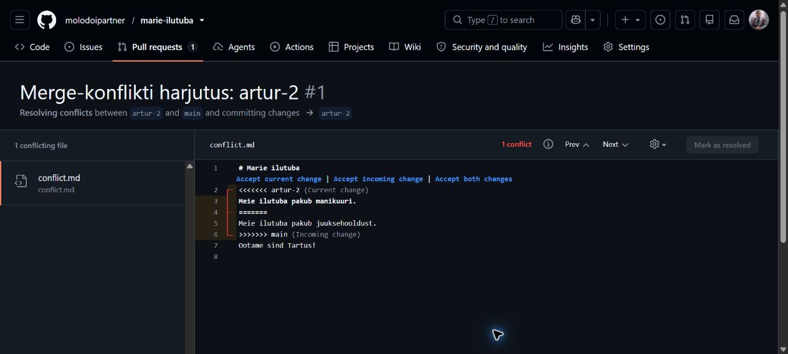

# Marie ilutuba

Sissejuhatus erialasse, 9. seminari iseseisev töö. Autor: Artur Golovko.

## Veebileht

Kujuteldava ilutoa leht HTML-i, CSS-i ja väikese JavaScripti galeriiga. Avalehe paigutus järgib kliendi visandit: vasakul nimi, menüü ja galerii; paremal sotsiaalmeedia, Google Maps, aadress ja lahtiolekuajad. Telefonis paiknevad veerud üksteise all.

- `index.html` – avaleht, kahe pildiga galerii ja Google Mapsi kaart.
- `hinnakiri.html` – näidishinnakiri.
- `broneeri.html` – ainult teade, et leht on valmimisel; broneerimise funktsionaalsust ei ole ülesande kohaselt tehtud.
- `style.css` – ühine kujundus ja mobiilivaade.
- `galerii.js` – galerii eelmine/järgmine pilt.

Avamiseks laadi failid alla ja ava `index.html` brauseris. Google Maps ja Google Fonts vajavad internetti. Pildid ning taustatekstuur on kohalikud. Aadress Rüütli 10, Tartu, lahtiolekuajad ja hinnad on õppimiseks valitud näidisandmed, mitte päris ettevõtte info. Instagram ja Facebook on ainult ikoonid; Tumblr viib Photos Worth Seeing fotoblogisse.

## Merge-konflikti harjutus

Täitsin mõlema tudengi rolli kahes kohalikus koopias. Harud `artur-1` ja `artur-2` on GitHubis alles.

1. Lõin faili `conflict.md` ja laadisin selle `main` harusse.
2. Kloonisin sama repositooriumi teise kausta.
3. Lõin harud `artur-1` ja `artur-2` ning laadisin mõlemad üles.
4. Muutsin mõlemas harus faili teist rida: esimeses lisasin juuksehoolduse, teises maniküüri. Tegin mõlemas commit'i ja push'i.
5. Ühendasin `artur-1` haru `main` harusse ja laadisin tulemuse üles.
6. Teises koopias läksin `main` harule, tõmbasin uuendused ja käivitasin `git merge artur-2`. Git teatas konfliktist.
7. Salvestasin sama konflikti kuvatõmmise GitHubi konfliktiredaktoris, enne lahendamist.
8. Lahendasin konflikti kohalikus failis: säilitasin mõlemad teenused ühes lauses, eemaldasin konfliktimärgid, käivitasin `git add conflict.md`, tegin merge-commit'i ja `git push origin main`.

### Miks on oluline osata konflikte lahendada?

Meeskonnatöös võivad mitu inimest muuta sama faili sama kohta. Git ei oska alati otsustada, milline muudatus alles jätta. Konflikti lahendamisel tuleb mõlemad variandid läbi vaadata, et kellegi töö ei läheks kaotsi ja lõpptulemus oleks loogiline. Selles harjutuses jätsin alles nii juuksehoolduse kui ka maniküüri.

Harjutuse pull request: https://github.com/molodoipartner/marie-ilutuba/pull/1

Juhend: [GitHub – Resolving a merge conflict using the command line](https://docs.github.com/en/pull-requests/how-tos/merge-and-close-pull-requests/resolving-a-merge-conflict-using-the-command-line).

## Piltide allikad

- Salongi foto: [Unsplash](https://images.unsplash.com/photo-1600948836101-f9ffda59d250).
- Maniküüri foto: [Unsplash](https://images.unsplash.com/photo-1604654894610-df63bc536371).
- Fondid: Google Fonts, Cormorant Garamond ja DM Sans.
- Tapeedilaadne taust on SVG-mürafilter. Sotsiaalmeedia ikoonid on lihtsad SVG-d.
